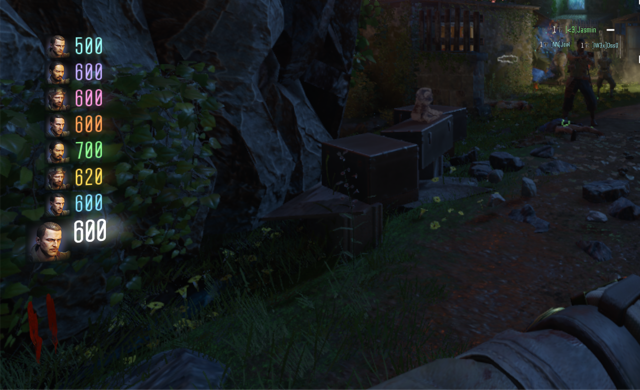

# More Players (Black Ops 3 zombies)

A Black Ops 3 mod that lets up to 8 players into one zombies match. No new weapons, perks
or menus. The HUD gets only what players 5 to 8 need: four more score rows and their
revive icons. With 4 players or fewer the game plays as it does without the mod.

## Status

| | |
| --- | --- |
| **BOIII client (CB Servers)** | Works. Built on this PC without the Mod Tools and run with 8 players (the host and 7 bots) on all 14 maps. Shawn also played it by hand on The Giant. |
| **With real people in slots 5 to 8** | Not tried yet. Every test so far had bots there. |
| **Steam game and Workshop** | Not built. That needs the Mod Tools and L3akMod, which are not on this PC. The source is laid out for them. |

Details are under [What was tested](#what-was-tested).

## Play it on BOIII

```bash
./build-boiii.sh --install
```

That builds the mod and copies it into the BOIII game folder (the one with `boiii.exe`,
default `~/Games/Bo3/bo3_game_files`; pass another folder after `--install`). It needs
Atian Tools, see [Test and build tools](#test-and-build-tools).

In the game: **Mods** on the main menu, pick **More Players**, wait for the reload, then
**Zombies** and **Private Game**. The lobby says "8 Max".

`./build-boiii.sh --remove` takes it out again.

**Friends** need the same files. The build also writes `dist/more-players-boiii.zip`.
They unpack it into their BOIII game folder, so that these two folders land there:

```
mods/more_players/                  the game scripts, as a mod
boiii/ui_scripts/more_players/      the menu and HUD part
```

Then they pick More Players under Mods before joining. Both parts are needed by everyone:
the first holds scripts that the host and the players must agree on, and without the
second a player's HUD has no colour for a 5th player's score. How BOIII behaves when
someone joins without the mod was not tried.

## Build it for the Steam game

Not done yet. What it needs:

| What | Where from | Why |
| --- | --- | --- |
| Black Ops 3, installed through Steam | your Steam library | the Mod Tools install into its folder |
| Call of Duty: Black Ops III - Mod Tools | Steam library, with "Tools" ticked in the filter | they hold the linker that builds the mod, and the publish button |
| L3akMod | community patch, link on the [Modme wiki](https://wiki.modme.co/wiki/black_ops_3/lua_(lui)/Installation.html) | the stock linker refuses Lua files, and this mod needs two |

L3akMod is one file. It replaces `bin\libtiff64r.dll` in the Black Ops 3 folder (keep a copy
of the original) and needs the Microsoft Visual C++ 2013 and 2015 x64 runtimes. It is only
used while building. Nothing from it ends up in the mod, and players do not need it.

Build and publish on **Windows**. The project is on the shared drive, so Windows sees it as
`G:\Projects\cb-mods\BO3\more-players`. Running the Mod Tools on Linux through Proton was not
tried.

1. Install the three things above.
2. Run `install.bat` from this folder. It makes `mods\more_players` in the Black Ops 3
   folder point at the `more_players` folder here. If Black Ops 3 is not in the default
   Steam folder, pass its folder: `install.bat "D:\Steam\steamapps\common\Call of Duty Black Ops III"`.
3. Start the Mod Tools from Steam. In its list of maps and mods, under **Mods**, find
   `more_players` and tick `core_mod` and `zm_mod`. Leave `mp_mod` and `cp_mod` unticked.
4. Tick **Link**, untick **Run**, press **Build**.
5. The result is in `more_players\zone\`. `zm_mod.ff` and `core_mod.ff` must be there.

If the build stops with an error, the message names the file and line. The scripts compile
with Atian Tools and run in the game, but they have never been through the Mod Tools
linker, and the two differ in small ways.

One check to run once the Mod Tools are installed, from Git Bash on Windows or from Linux:

```bash
test/check-stock-copies.sh "<black ops 3 folder>"
```

Three scripts in the mod are the game's own with a few lines added. This compares them with
the originals in your Mod Tools and fails if the originals have changed.

To load it in the Steam game: **Mods** on the main menu, pick More Players, wait for the
reload, then Zombies and a private or custom game lobby.

A build made with the Mod Tools also works in BOIII and needs no second folder there: the
Lua is inside the mod. If you switch to it, run `./build-boiii.sh --remove` first, or the
Lua is in twice.

## Publish to the Workshop

Publishing is done from your own Steam account, in the Mod Tools, on Windows.

1. Build the mod with the Mod Tools (above) and try it first.
2. Optional: copy `more_players\workshop.example.json` to `more_players\zone\workshop.json`.
   The publish window then opens with the title and description filled in. Its
   `PublisherID` of `0` means "new item".
3. In the Mod Tools, tick `zm_mod` under `more_players`.
4. Menu **Edit**, then **Publish**. A window named Publish Mod opens.
5. Fill in **Title** and **Description**, pick a **Thumbnail** picture, tick the **Tags**
   that fit, and confirm.
6. The Mod Tools upload the whole `more_players\zone` folder. On the first upload Steam may
   ask you to accept the Workshop terms. When it finishes, the item's Workshop page opens.
7. On that page, set who can see it. Friends-only or Unlisted is right while testing.

The Mod Tools write the new item's number into `zone\workshop.json`. Publishing again
updates the same item, so keep that file.

The BOIII build from `build-boiii.sh` is not for the Workshop: it has no Lua and no
settings file inside.

## What it changes

| Stock behaviour | With the mod |
| --- | --- |
| Every zombies lobby type holds 4. | They hold 8. PLAYER LIMIT under Social goes up to 8. |
| The match itself is set to 4 players. | 8. |
| When anyone spawns with more than 4 players in the match, the game freezes everyone and ends. It is an anti-cheat check. | The check is off. |
| The time between zombie spawns is looked up by player count, 1 to 4. With 5 the lookup has no answer and the round code breaks. | 5 or more players use the 4-player value. |
| Start points are picked by player number. A map has 4, so players 5 to 8 land inside another player, and the game downs players who stand in each other. | A player who spawns inside another is moved to the nearest free spot in the same room. Works for respawns too. |
| With all four characters taken, every extra player becomes character 1. | Extra players get whichever character the fewest players are using, so 8 players are two of each. |
| The revive countdown is sent per player slot, for slots 1 to 4. Downing a player in slot 5 takes the server down. | Slots 5 to 8 have one. |
| The revive icon above a downed player is drawn by the engine, for 4 players. | For slots 5 to 8 the mod draws the game's own icon itself, at the downed player, and switches it to "being revived" with the ring filling while somebody revives them. |
| "X is reviving you" takes its name from a list of 4. A reviver in slot 5 or higher has none, which can break the revive. | Slots 5 to 8 reuse the four names. |
| The HUD colours each player's score with a setting that exists for 4 players. For a 5th it is an error in the HUD of everyone who sees that player. | Slots 5 to 8 get colours of their own. |
| The points pop-ups next to the score are sent per slot, for 4 slots. Sending one for slot 5 takes the server down. | Not sent for slots 5 to 8. Their score still shows and still changes. |
| The score list at the bottom left has 4 rows. | 8 rows. |
| The scoreboard shows 4 rows. | 8 rows. |
| The GobbleGum machine decides how often it moves by player count, 1 to 4. | 5 or more count as 4. |
| A player's five GobbleGums come from the engine when they connect. | If the engine hands a player in slot 5 to 8 an empty pack, they get the five starter gums, so the machine has something to give. |
| Five maps send things of their own per player slot, for 4 slots: the fuse icon on Der Eisendrache, the wearable icon on Gorod Krovi, Revelations and Moon, the challenge pillars and the ending portal on Zetsubou No Shima. Setting one for slot 5 takes the server down. | Slots 5 to 8 have them, with the size each map uses. |

Round size needs no change: the game already adds zombies per player, so 8 players get
bigger rounds (15 zombies in round 1 instead of 6 alone). The game keeps at most 24 zombies
alive at once whatever the player count, so the extra zombies make rounds longer, not
crowds thicker.



## Characters

Each map hands out its own four characters. Players 5 to 8 share them: same body, same
voice as the player they double.

Using the other crews as extra characters (Primis on a map with Ultimis, the Shadows of Evil
four elsewhere) is not in this version. Each map only loads its own crew's models, so the
others would have to be packed into the mod, and that needs the Mod Tools. That is the next
stage.

## What was tested

### In the game (BOIII client, this PC)

`test/bot-test.sh` starts the game, walks the menus, loads the mod, starts a private match
with the host and 7 bots, runs its checks, plays three rounds by killing zombies as they
spawn, and quits. Each run counts as passed when the game wrote no crash dump, no script
error had one of the mod's files in its call stack, and the test reached its end.

| Map | Result with 8 players |
| --- | --- |
| The Giant | passed, on the final scripts |
| Kino der Toten | passed, on the final scripts |
| Verrückt | passed, on the final scripts |
| Shi No Numa | passed, on the final scripts |
| Ascension | passed, on the final scripts |
| Shangri-La | passed, on the final scripts |
| Gorod Krovi | passed, on the final scripts |
| Nacht der Untoten | passed, before the revive icon was added |
| Shadows of Evil | passed, before the revive icon was added |
| Der Eisendrache | passed, before the revive icon was added |
| Zetsubou No Shima | passed, before the revive icon was added. Without the mod's fields for this map it crashed. |
| Revelations | passed, before the revive icon was added |
| Origins | passed, before the revive icon was added |
| Moon | checks passed at the start, before the revive icon was added. Three rounds not reached, see Known limits. |

"Before the revive icon was added" means the run was made earlier in the evening. What
changed in the scripts after it is the marker the server keeps at a downed player in slot
5 to 8, which is the same on every map.

What a run checks:

- The lobby is 8 and the match starts with 8 players. Nobody is frozen by the player-count
  check.
- Where each player ended up after spawning, and which character they got: two of each.
- A player in slot 2 (as the control), slot 6 and slot 7 is downed. The game's bots then
  walk over and revive them, which is the game's own revive. The mod's icon reported
  "showing" while slots 6 and 7 were down and "being revived" while a bot revived them.
- GobbleGums are given to players in slots 1, 2, 6 and 7 and arrive.
- On the five maps with per-slot things of their own, the one for slot 6 is set and read
  back.
- Three rounds go by with 8 players and their bigger rounds.

Also run:

- **The Giant to round 15** with 8 players, no crash. This was on an earlier build of the
  scripts, before the revive icon was added.
- **Without the fixes**, to see that they are needed: downing a player in slot 6, a points
  pop-up for slot 5 or higher, and the challenge pillars on Zetsubou No Shima each took
  the game down until the mod covered them.
- **The installed build**: after `./build-boiii.sh --install`, one more run on The Giant
  with the mod loaded under its real name, `more_players`. Same result.
- **By hand** (Shawn, The Giant): the lobby, the 8-row scoreboard at game over, the 8-row
  score list, and the revive icon for a downed bot in slot 5 or higher, including the
  "being revived" look.

### Without the game

```bash
lua5.1 test/lua-mock-test.lua
test/check-server-client-match.sh
test/check-stock-copies.sh <a Mod Tools scripts folder>
```

- The Lua, against a stand-in for the game's UI functions: 61 checks on the lobby size,
  the score colours, the scoreboard, the score list and the revive icons. Deliberate bugs
  put into the Lua were each caught by it (14 for the revive icons alone).
- That the server script and the client script register the same per-slot fields.
- That the three scripts taken from the game are the originals plus the added lines,
  against a public copy of the Mod Tools scripts.
- `install.sh`, against a throwaway folder: link, link again, remove, copy.

### Not tested

- **Real people in slots 5 to 8.** Bots do not have a profile, a loadout, a HUD of their
  own or a network connection.
- **Joining.** Who gets the mod how, and what happens to someone without it.
- **The Mod Tools build**, `install.bat`, and publishing.
- **The Lua loaded from inside a mod.** The tests gave it to BOIII as a plain file. A Mod
  Tools build loads it through `ui/t7/utility/codutilityrequire.lua` instead.
- **The Steam game.** Everything was run on BOIII.
- **Long games** on any map but The Giant, and easter eggs and boss fights on all of them.

## Known limits

- **Revive icon for slots 5 to 8:** it is the mod's, not the engine's. It stops at the
  edge of the screen when the player is out of view but has no arrow pointing to them.
- **Points pop-ups** (the +10, +50 next to the score): not shown for slots 5 to 8.
- **"X is reviving you":** for a reviver in slot 5 to 8 the name shown is the one of the
  slot four lower.
- **GobbleGums:** bots have no GobbleGum pack, so the tests only show that the machine
  and the gums work for slots 5 to 8 once a pack is there, and that the starter pack is
  put in when the engine gives none. Whether a real player's own pack arrives in slots 5
  to 8 is not known. Other 8-player mods report that it does not, which is what the
  starter pack is for.
- **Long games:** players of All-around Enhancement, which also has 8-player lobbies,
  report crashes around round 12 with 6 players. The Giant ran to round 15 here with 8.
  That is one run on one map.
- **Easter eggs and boss fights:** not looked at. Map scripts have cases for 1 to 4
  players in places the tests never reach. The per-slot things that crash the game were
  searched for in every map's scripts and covered, but a step that simply does nothing
  for player 5 can not be found that way.
- **Moon:** the test can not get out of the starting area by itself, so Moon was only
  checked at the start, not over three rounds.
- **Joining late:** a player who arrives after the match has started watches until the
  next round. That is the game's own rule and the same with the mod. In the bot test the
  8th bot always arrives that way.
- **Stats and leaderboards:** unknown. The game picks a leaderboard by player count, 1 to 4.
- **Custom maps:** should work, since the mod only uses hooks that the Mod Tools scripts
  have too, but a custom map with its own HUD or spawn code may differ.
- **Public matches:** the mod does not try. A modded game is a private or custom lobby.

## Test and build tools

**Atian Tools** stand in for the Mod Tools on this PC. They compile the game scripts and
pack them into a mod file, which is all BOIII needs. Download `acts.zip` from
[github.com/ate47/atian-cod-tools/releases](https://github.com/ate47/atian-cod-tools/releases),
unpack it, and set `ACTS_DIR` to the folder that holds `bin/acts.exe` (default
`/var/tmp/bo3-acts/acts/acts`, which does not survive forever). It is a Windows program and
runs through Proton's wine. `tools/acts-build.sh` has the build steps and the three small
things it changes in a copy of the scripts first, because Atian Tools read a slightly
smaller script language than the Mod Tools.

**`test/bot-test.sh`** is the test described above:

```bash
test/bot-test.sh --map zm_castle --rounds 3 --seconds 540
```

`--map` takes the game's name for a map (`zm_factory` is The Giant, the default). `--stock`
leaves the mod out, `--no-tests` skips the scripted checks, `--keep` leaves the test files
in the game folder. The game window opens and takes the keyboard while it runs. If the
game freezes, close its window by hand: the script only waits.

It puts three things into the game folder and takes them out at the end: a test copy of
the mod (`mods/mp_test`), a script that adds the bots and runs the checks
(`boiii/custom_scripts/zm/zz_mp_debug.gsc`) and a Lua file that walks the menus and quits
the game (`boiii/ui_scripts/zz_mp_autostart`). The game itself leaves `console_mp.log` in
its folder, and a crash leaves a file in `minidumps/`.

## How it works

A mod can replace any of the game's script or Lua files by shipping one with the same name.
This mod replaces as little as it can, and where it does, the file is the original with
lines added:

| File | What it is |
| --- | --- |
| `scripts/zm/gametypes/_clientids.gsc` | original plus one line that loads the mod's server script |
| `scripts/zm/_zm_score.csc` | original plus one line that loads the mod's client script |
| `scripts/zm/_zm_score.gsc` | original plus one check that skips the points pop-up for slots 5 to 8 |
| `ui/t7/utility/codutilityrequire.lua` | original list plus one line that loads the mod's Lua |
| `gamedata/configs/zm/zm_default_gamesettings.cfg` | original with two 4s changed to 8 |
| `scripts/zm/zm_more_players.gsc` | new: server side |
| `scripts/zm/zm_more_players.csc` | new: client side, the per-slot fields for slots 5 to 8 |
| `ui/more_players/more_players.lua` | new: lobby size, score colours, scoreboard rows, score list rows, revive icons |

The server script changes the game through settings the game's scripts already read before
acting: which function gives the spawn delay, which function hands out characters, whether
the player-count check runs. It keeps whatever a map had set there and calls it for 4
players or fewer.

Much of the game sends things to the players through fields that are set up once, by name,
on both the server and the client, one per player slot and for 4 slots. Setting a field
that was never set up takes the server down. That is why downing a 5th player crashed the
game, and it is most of what the two new scripts do: set up the missing fields for slots 5
to 8, the same on both sides.

The revive icon is the one thing the engine itself draws for 4 players only. For slots 5 to
8 the server script keeps a nameless world objective at a downed player, switched on while
they are down, with the revive progress as its progress value. The engine sends objectives
to every player. The Lua places the game's own revive icon widget on that objective and
feeds it the state.

The lobby is opened by a second Lua environment that starts with the game, long before a
mod loads, and its copy of the lobby sizes can not be reached from a mod. What a mod can do
is what the PLAYER LIMIT option does: tell the engine a new size for a lobby you host. The
mod does that whenever the menus ask for the lobby size and a zombies lobby hosted by you
is below 8. This is also why it has to be a mod and can not be a custom map: a map loads
after the lobby exists.

`zone_source/core_mod.zone` lists what goes into the part of the mod the menus load, and
`zone_source/zm_mod.zone` what a zombies match loads. `mp_mod` and `cp_mod` are the empty
templates the Mod Tools expect.

The number 8 is in four places that must agree: `zm_more_players.gsc`, `zm_more_players.csc`,
`more_players.lua` and the settings file. Other mods run zombies with up to 18, so the
engine's own limit is above 8.

## Sources

- Stock scripts: the Mod Tools script sources as mirrored at
  [zeroy99/bo3_modtools](https://github.com/zeroy99/bo3_modtools), and a decompile of the
  current game at [ate47/bo3-source](https://github.com/ate47/bo3-source).
- Stock Lua: [KingslayerKyle/T7LuaRepo](https://github.com/KingslayerKyle/T7LuaRepo),
  `Dumps/PC_Ship_2025-05-31`.
- Build and publish steps: the Mod Tools Launcher's own source,
  [TreyarchGames/ModLauncher](https://github.com/TreyarchGames/ModLauncher).
- The compiler and packer used here: [ate47/atian-cod-tools](https://github.com/ate47/atian-cod-tools).
- What the BOIII client loads from where: [CBServers/boiii](https://github.com/CBServers/boiii).
- What others had to change for more players, used to check the list here:
  [JezuzLizard's 18-player server mod](https://github.com/JezuzLizard/T7-18-Player-Dedicated-Zombies-Server-Mod)
  and [olie304's notes](https://github.com/olie304/BO3-18-Player-Zombies).
- Two of the files this mod loads through, `_clientids.gsc` and `codutilityrequire.lua`,
  are the ones the mod [TF's Zombie Options](https://github.com/kollier-p/TFs-Zombie-Options)
  uses for the same purpose. Both hook scripts are loaded by the game's zombies loader,
  `scripts/zm/_load`, on every map.
