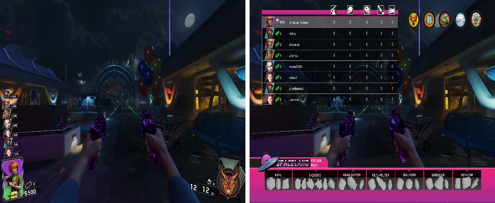

# More Players (Infinite Warfare zombies)

Makes zombies on the [iw7-mod](https://github.com/auroramod/iw7-mod) client an 8-player
mode: the lobby holds 8, the game's 4-player assumptions are patched, the HUD and
scoreboard show everyone, and with more than 4 players the Magic Wheel can hand out wonder
weapons the team has already built.



**Status: tested with bots on 2026-11-22, not yet with 8 real players.** See
[What was tested](#what-was-tested).

## Who needs what

| File | Runs on | Needed by |
| --- | --- | --- |
| `custom_scripts/cp/more_players.gsc` | the host | host |
| `custom_scripts/cp/scoreboard.gsc` | the host | host |
| `ui_scripts/MorePlayers/__init__.lua` | each player's menus and HUD | everyone |
| `ui_scripts/ZombiesPlayers/__init__.lua` | each player's HUD | everyone |
| `ui_scripts/MorePlayersLobby/__init__.lua` | the host's menus | host, and only with the mod picked in the Mods menu (see Install) |

The first two `ui_scripts` files are not optional for joiners. Without `ZombiesPlayers`, a player
who lands in slot 5 or higher gets falling FPS and is kicked after a while, because the stock
HUD can not build for that slot.

The simplest rule: everyone has the first four (they are what the mod and the always-on zip
contain), and whoever hosts with the mod picked in the Mods menu adds the fifth.

## Install

```bash
./install.sh
```

That copies the four files into `~/Games/Infinite-Warfare/iw_game_files/iw7-mod/`. Pass
another game folder as the first argument if yours is elsewhere. `./install.sh --remove`
takes them out again.

`scoreboard.gsc` and `ZombiesPlayers` are iw7-mod's own fix, not written here. The first
install downloads them from iw7-mod's GitHub (about 8 KB, one fixed commit, checksum checked)
with `fetch-hud-fix.sh`.

When a later iw7-mod release ships `ZombiesPlayers` itself, run `./install.sh --remove` and
reinstall only `more_players.gsc` and `MorePlayers`, so the release's own copies are used.

### For friends, or on Windows: the zip

`dist/more-players-iw7.zip` (10 KB) holds the same four files. To install it:

1. Open the game folder. In the CB Servers launcher: Infinite Warfare, then Browse Local Files.
2. Extract the zip into that folder. It adds files inside the `iw7-mod` folder that is
   already there and replaces nothing.

`./make-zip.sh` rebuilds the zip after a change.

### As a mod you pick in the game (the normal way)

Download `iw-more-players.zip` from the [releases page](https://github.com/ShawnDuPreez/cb-mods/releases) and extract it into your
game folder, the one that holds `iw7-mod.exe` (in the CB Servers launcher: Infinite Warfare >
Browse Local Files). Start the game, open the Mods menu and pick MORE_PLAYERS, then host a
Custom Game.

The zip puts two things in place:

- `mods/more_players/`, the mod itself. Every player needs it.
- `iw7-mod/ui_scripts/MorePlayersLobby/`, the lobby script. Only the host uses it.

Why the second one: right after a mod is picked, the game runs nothing from that mod's folder
and starts its menus before the mod's `mod.ff` is ready. Only files in the game's own
`iw7-mod` folder are used at that point. So without the lobby script the first match after
picking the mod starts with 4 slots, and only the second one with 8. The lobby script does
the one thing the lobby needs, and nothing unless MORE_PLAYERS is the loaded mod.

From a copy of this repository, `./install.sh --menu` installs just the lobby script.

- Use this form or the always-on files, not both. If the files are also in `iw7-mod/`, those win.
- Tested on 2026-11-22 without the lobby script: picked in the Mods menu, hosted a Custom
  Game on Spaceland with 7 bots. 8 slots, HUD scripts loaded from `mod.ff`, no errors in the
  log. The game's log from that evening shows the mod's own lobby script first loading on
  the way back from a match, so that 8-slot match was most likely not the first one after
  picking the mod.
- **Not tested: the lobby script in the real game**, i.e. 8 slots in the very first match
  after picking the mod. `test/lobby-lua-test.lua` checks its logic against stand-ins for the
  game's functions (16 checks, each confirmed to fail when its line is broken).
- Not tested: the launcher's Import itself, and a friend joining. A friend needs the same
  `mod.ff`; iw7-mod's code then switches their game to the mod when they join.
- The first version of this form crashed the game. The game loads a mod folder's game scripts
  but not its menu and HUD scripts, so those are packed inside `mod.ff` instead (`luafile`
  lines in `zone_source/more_players.csv`). `custom_scripts/frontend/more_players_lobby.gsc`
  in the mod folder also sets the lobby size, but like everything in the mod folder it only
  runs once a match has been played.
- `mod/mod.ff` is kept in this project and reused, because every player needs the identical
  file. `../tools/build-mod-ff.sh more-players more_players` rebuilds it with zonetool
  (x64-zt) through Proton; the top of that script says what it needs. A rebuild from
  unchanged files gives the same file byte for byte (checked 2026-11-22). The file only has
  to change when `ui_scripts/MorePlayers` or `ui_scripts/ZombiesPlayers` does; the `.gsc`
  files and the host's lobby script are not in it.

### Bots for trying it alone

`extras/more_players_bots.gsc`, copied to `<game folder>/iw7-mod/custom_scripts/cp/`, adds
bots to a match you host. In the console before starting the match: `set more_players_bots 7`.
They join about 12 seconds in and stand still.

## Play

1. Zombies menu, then Custom Game. The lobby now holds 8.
2. Others join the host as usual.

Solo is unchanged. On a dedicated server, put `set party_maxplayers 8` in the server config;
the lobby script does not apply there.

## With All Perks and Perk Limit

[All Perks](../all-perks/README.md) (start with every perk) and
[Perk Limit](../perk-limit/README.md) (the host picks how many perks a player may hold) are
separate small mods. The game's Mods menu loads one mod at a time, and they are meant to be
used that way: one at a time, not together with More Players.

If you do want them at once, both small mods can also be installed as always-on files with
their own `install.sh`. Those sit in the game's `iw7-mod` folder and work beside whichever
mod is loaded. `../tools/combined-test.sh cp_zmb` runs the three together in that arrangement
on a private server with bots, and it passes.

## What it changes

**Lobby** (`MorePlayers`): the zombies menu sets the lobby size to 4 each time it opens. The
script turns that 4 into 8.

**Game scripts** (`more_players.gsc`):

| Stock behaviour | With the mod |
| --- | --- |
| The character pool holds 4. Player 5 gets no character and a script error. | Extra players get the map's guest star first, then a second copy of whichever of the four main characters the fewest players are using. |
| Start spawn is picked by player slot from 4 points. Slot 6 and up never spawn. | Extra slots start next to a stock point, on the spot with the most room that a player could walk to from it. Zombie-only rooms behind windows are left out. |
| HUD portraits are written by slot into 4 places. Higher slots cause a script error on every portrait update. | Slots 5 and up are sent to the HUD another way. No error. |
| Two revive progress bars exist. A third revive at the same time errors and the revive breaks. | A third revive works. Onlookers just see no bar for it. |
| Zombie targeting groups exist for 4 players. Asking for a 6th is a script error. | Each player takes a free group. With all four taken, zombies target the rest by the normal rules. |
| Ghosts 'n Skulls teleports are picked by player slot. | Extra slots reuse the spots. |
| Spaceland team-door counters are left unset above 4 players. | 5 or more players count as 4. |

**HUD and scoreboard** (iw7-mod's `ZombiesPlayers` and `scoreboard.gsc`, plus `MorePlayers`):

- The HUD builds for every slot, so nobody lags out.
- The teammate list shows up to 7 others. The scoreboard shows 8 rows with real stats.
- Players in slot 5 and up show their own character's portrait.
- The game log stays quiet. iw7-mod's scoreboard fix on its own writes about 15 blank error
  lines a second with 8 players; `MorePlayers` stops the call that causes them.

Wave size needs no change. The game already scales it by player count. The limit of 24
zombies alive at once stays, so more players means longer rounds, not bigger crowds.

## Wonder weapons from the Magic Wheel

Two maps have wonder weapons that exist once each, so with 5 to 8 players some never get
one. While **more than 4 players** are in the game, a wonder weapon that has **already been
built** is also put in the Magic Wheel, as one more weapon in its list.

| Map | Weapons | Counts as built when |
| --- | --- | --- |
| Zombies in Spaceland | Dischord, Face Melter, Head Cutter, Shredder | all three parts are on its stand, or a player has held it |
| Rave in the Redwoods | Acid Rain, Ben Franklin, Trap-o-Matic, Whirlwind EF5 (the four upgraded harpoon guns) | a player has held it |

- The chance is the wheel's own: each built weapon is one entry among the wheel's 35 to 37
  weapons, so about 1 spin in 40 for a given one and about 1 in 10 for any of them once all
  four are built.
- The wheel never offers a weapon the spinning player already holds, so nobody gets a second
  copy of the same one.
- On Spaceland it hands out the plain version, the same as the stand does.
- When the game drops to 4 players or fewer, they leave the wheel again. Weapons already won
  are kept.
- With Director's Cut on, nothing changes: Director's Cut already puts all of them in the
  wheel from the start.
- To switch this off, type `set more_players_wheel_wonder_weapons 0` in the console.

**The other three maps need no change**, because the game already lets every player get
their own copy, whatever the player count:

| Map | Weapon | How every player gets one in the normal game |
| --- | --- | --- |
| Shaolin Shuffle | Nunchucks | Finishing the clock quest forces them on your next spin, and puts them in the wheel for everyone. |
| Shaolin Shuffle | Katana | A wall buy after the Rat King fight, one per player. |
| Attack of the Radioactive Thing | M.A.D. | The wheel already gives the base gun 1 spin in 10, there is a pickup for it too, and the three parts can be used by every player. |
| The Beast from Beyond | Venom-X | Once the puzzle step is done every player can take one from the wall, and the first one taken puts it in the wheel. |

This was worked out by reading the game's scripts, not by playing those quests.

## Characters per map

Each map only loads its own cast. The guest stars' models are stored inside their own map's
files and nowhere else, so a script can not use Kevin Smith on Spaceland.

| Map | Unique characters |
| --- | --- |
| Zombies in Spaceland | 6: the four, David Hasselhoff, Willard Wyler |
| Rave in the Redwoods | 5: the four, Kevin Smith |
| Shaolin Shuffle | 5: the four, Pam Grier |
| Attack of the Radioactive Thing | 5: the four, Elvira |
| The Beast from Beyond | 4: the four |

Past that number, players share a character: same model, same voice.

To keep guest stars for players who picked them in the menu, and give extra players
duplicates only, type this in the console before the match:

```
set more_players_guest_stars 0
```

**All 9 on every map** would take an asset pack, not a script. iw7-mod loads a file named
`mod.ff` on every map. One built with zonetool, holding the five guest models pulled out of
their maps, would make them available everywhere; `more_players.gsc` would then register them
as extra characters. They would have no voice lines outside their own map. Not started.

## What was tested

On the CB Servers build of iw7-mod (v1.2.0), with bots standing in for players.

**Host side, a private server with 8 bots, on all five maps:**

- Every slot spawns and plays, each with a character: the map's guest star goes to slot 5
  (both guests on Spaceland), then the four main characters are doubled up. A guest star is
  never handed out twice by the mod.
- Extra players start at least 47 units from anyone else, which is how close the game's own
  start points get. A player is about 30 wide.
- Three revives at once: bars 1 and 2 are handed out, the third revive runs without one.
- The Ghosts 'n Skulls teleport works for slot 7.
- A player leaving and one rejoining keeps the character pool consistent.
- No script error comes from this mod's files. The log does fill with errors from the game's
  own scripts, because bots have no player profile; real players do not cause those.

**Player side, the real game:**

- The zombies menu loads normally and the lobby size reads 8 as soon as it opens.
- A Custom Game hosted from the menu has 8 slots. With 7 bots added, the HUD shows the 7
  teammates with portraits and cash, and the scoreboard shows 8 rows (the picture above).
- Joining someone else's 8-slot server as the 8th player works: no errors, no lag-out,
  correct portraits and stats for slots 5 to 8.

**Wonder weapons in the Magic Wheel, the same private server with 8 bots (2026-11-22):**

- Spaceland: nothing is added at the start, or with two of a weapon's three parts on its
  stand. With the third part placed, Dischord is in the wheel's list (37 weapons become 38).
  A bot given a Face Melter adds that one too.
- Rave: a bot given a Ben Franklin adds it to the list (35 become 36).
- On both maps a real spin by another bot, with the wheel's list narrowed to that weapon so
  the result is known, shows the weapon and hands it over. After that the wheel's own filter
  no longer offers it to that player.
- With 5 players left the weapons stay in the list, with 4 they are gone, with 5 again they
  are back, and the console switch removes them.
- Shaolin Shuffle, Radioactive Thing, Beast from Beyond: the mod changes nothing in the list.
- The earlier 8-bot checks were run again on Spaceland with the changed script and still
  pass. No script error comes from the mod's files in any of these runs.

To repeat the host-side tests after changing the script (about 90 seconds, one map per run):

```bash
test/bot-test.sh cp_zmb
```

```bash
test/bot-test.sh cp_zmb 2
```

The first starts a private, unlisted server with 8 bots and prints who got which character
and spawn, plus any script error that comes from the mod's files. The second runs the Magic
Wheel checks instead.

**Not tested:**

- A wonder weapon coming out of the Magic Wheel in the real game: how it looks on the wheel,
  and a player really building one first. The test sets the "built" state by script.
- 8 real people. Bots do not move, shoot, buy or revive.
- A long game. Runs lasted a few minutes of round 1.
- Joining over the internet from another PC.
- Boss fights, Easter eggs, the roller coaster, Director's Cut.

## Known limits

- **Lobby list:** the member list shows 4 rows at a time.
- **Portraits for slots 5 and up:** always the healthy picture, and they can show the wrong
  character for the first moments of a match, until anyone's portrait next updates.
- **Microphone icons:** hidden on the scoreboard while more than 4 players are in the game.
- **End of game screen:** lists 4 players. Its data table has 4 rows.
- **Spaceland roller coaster:** its score display has 4 slots. Scores for players 5 and up
  are not shown and may not count.
- **Director's Cut, straight-to-boss mode:** its spawn points are picked by player slot and
  are not patched.
- **Boss fights and Easter egg steps:** many scale by player count with cases for 1 to 4
  only.
- **Banter between the four characters:** the game only plays it with exactly 4 players.
- **Guest star side effects:** a player given Hasselhoff, Kevin Smith or Elvira by the mod
  triggers that character's achievement call, the same as picking them in the menu.
- **iw7-mod's `spawnBot` command:** crashes a zombies server in a loop. It is not part of
  this mod; do not use it in zombies.

## How it works

iw7-mod loads every `.gsc` in `custom_scripts/cp/` when a zombies match starts and runs its
`main()` and `init()`. `main()` uses iw7-mod's `replacefunc` to swap ten functions in the
game's scripts for the versions in `more_players.gsc`. A replaced function can not be called
again, so each one is a full rewrite of the original with the 4-player assumption removed.

The wonder weapons replace nothing. The wheel picks from the list `level.magic_weapons`, and
Director's Cut adds the wonder weapons to that list under fixed names. Once a second the
script checks which ones are built and how many players are in, adds or removes those same
names, and reshuffles the list of every wheel that is not spinning.

iw7-mod also loads every folder in `ui_scripts/` that has an `__init__.lua`, both in the
menus and in a match. `MorePlayers` wraps four of the game's own Lua functions: the one that
sets the lobby size, the two that pick a portrait, and the multiplayer scoreboard call.

The game stores every player's character and health picture in one number per value, 3 bits
per player, and those numbers only have room for 4 players. So for slots 5 and up the host
sends the portrait in a text setting (`ui_cp_characters`) once it changes, the same way
iw7-mod's fix sends the scoreboard (`ui_cp_scoreboard`).

A file in `<game folder>/iw7-mod/` replaces a file of the same name that ships with iw7-mod.
That is why nothing here is named `patches.gsc`.

To see script errors while testing, start the game or server with `+set developer_script 1`.
iw7-mod then logs every script error with its file and function.

The stock scripts were read from public decompiles
([mjkzy/iw7-gsc-dump](https://github.com/mjkzy/iw7-gsc-dump) for game scripts,
[deshayu/iw7-dump](https://github.com/deshayu/iw7-dump) for menus). Every stock name
`more_players.gsc` uses was checked against the name table inside the installed
`iw7-mod.exe`.

## Credits

`ui_scripts/ZombiesPlayers/__init__.lua` and `custom_scripts/cp/scoreboard.gsc` are from
[auroramod/iw7-mod](https://github.com/auroramod/iw7-mod), pull request 714, commit
`22281d41`, licensed GPL-3.0.
